# Báo cáo kết quả: độ bền vững của YOLOv8n trước nhiễu tổng hợp

## Tóm tắt

Đánh giá YOLOv8n pretrained trên 500 ảnh COCO val2017 (3.799 box), so sánh ảnh sạch với Gaussian noise, Salt-and-Pepper, fog và low-light ở ba mức mỗi loại. Tổng cộng 25 điều kiện (clean, 12 raw, 12 recovered) được chạy trên RTX 3060. Qua ba seed tạo nhiễu (42, 43, 44), clean đạt mAP@0.5 = **0.5440**. Salt-and-Pepper giảm mạnh nhất: trung bình còn **0.2692 ± 0.0080** ở mức 0.06; median 3×3 nâng lên **0.5169 ± 0.0034**. NLM không giúp Gaussian nhẹ-vừa, còn CLAHE cải thiện một số điều kiện fog/low-light nặng.

Để kiểm tra ảnh hưởng của cách chọn subset, chạy thêm 9 điều kiện nặng trên hai subset COCO 500 ảnh không trùng. Qua ba subset rời nhau, S&P 0.06 đạt **0.2674 ± 0.0120** raw và **0.5185 ± 0.0283** sau median; kết luận định tính vẫn giữ qua các nhóm ảnh.

Phân tầng recall theo object size trên subset gốc cho thấy S&P 0.06 raw giảm recall small/medium/large xuống **0.113/0.273/0.385**; median khôi phục lên **0.168/0.482/0.731**. Kết quả dùng confidence 0.25 và IoU 0.5, đọc kèm phân tích chi tiết bên dưới.

Khi lặp phân tích theo kích thước trên cả ba subset, recall S&P raw trung bình là **0.098/0.267/0.389**; median nâng lên **0.168/0.481/0.736** (small/medium/large; SD giữa subset tối đa 0.014). Mẫu hình này ổn định hơn khi đổi nhóm ảnh COCO.

## Môi trường chạy và checkpoint

| Thành phần | Phiên bản / cấu hình |
|---|---|
| Hệ thống | Windows, Python 3.10.3 |
| GPU | NVIDIA GeForce RTX 3060 12 GB; CUDA khả dụng |
| PyTorch / Torchvision | 2.10.0+cu128 / 0.25.0+cu128 |
| Ultralytics / OpenCV | 8.4.204 / 4.13.0 |
| NumPy / PyYAML / Matplotlib | 2.2.6 / 6.0.3 / 3.10.8 |
| YOLO checkpoint | `yolov8n.pt`; SHA-256 `F59B3D833E2FF32E194B5BB8E08D211DC7C5BDF144B90D2C8412C47CCFC83B36` |
| SSDLite checkpoint | `SSDLite320_MobileNet_V3_Large_Weights.COCO_V1`; SHA-256 `A79551DF90C79834BCD3BB3845EF9D966B5449A3A9B2833AE8404778CA5D65D2` |

Các phiên bản gói trực tiếp được ghim trong `requirements-experiment.lock.txt`; snapshot đầy đủ `pip freeze` của môi trường Windows nằm ở `environment-snapshot-windows-cu128.txt` và có thể chứa gói không liên quan trực tiếp đến benchmark. Kết quả subset dùng YOLO input 640; so sánh detector với evaluator chung dùng input 320 cho cả hai mô hình, còn SSDLite có đầu vào 320 theo kiến trúc.

## Mở rộng: toàn bộ COCO val2017 — ảnh raw

Để giảm sai lệch do chọn subset, chạy clean và toàn bộ 12 điều kiện nhiễu raw trên **5.000 ảnh, đủ 80 lớp, 36.335 instances**. Dùng cùng YOLOv8n, imgsz 640, batch 16, GPU RTX 3060, seed 42. Recovery đã được xác nhận trên full val cho Salt-and-Pepper, fog và low-light; Gaussian-NLM recovery đã chạy ở level 0.06 trên full val và cả ba level trên subset 500 ảnh.

Baseline full val đạt mAP@0.5 **0.5185** và mAP@0.5:0.95 **0.3671**. Ở cường độ cao nhất, Gaussian giảm mAP@0.5 15.4%, Salt-and-Pepper 52.6%, fog 9.1%, low-light 11.4%.

| Điều kiện raw | Level | mAP@0.5 | mAP@0.5:0.95 | Δ mAP@0.5 so clean | FP* |
|---|---:|---:|---:|---:|---:|
| Clean | 0 | 0.5185 | 0.3671 | 0.0% | 8794 |
| Gaussian | 0.01 | 0.5161 | 0.3651 | 0.5% | 8639 |
| Gaussian | 0.03 | 0.4927 | 0.3449 | 5.0% | 8094 |
| Gaussian | 0.06 | 0.4387 | 0.3037 | 15.4% | 7098 |
| Salt-Pepper | 0.01 | 0.4337 | 0.3021 | 16.3% | 7440 |
| Salt-Pepper | 0.03 | 0.3464 | 0.2344 | 33.2% | 6237 |
| Salt-Pepper | 0.06 | 0.2459 | 0.1636 | 52.6% | 5212 |
| Fog | 0.15 | 0.5108 | 0.3615 | 1.5% | 8592 |
| Fog | 0.3 | 0.4985 | 0.3521 | 3.9% | 8327 |
| Fog | 0.5 | 0.4712 | 0.3320 | 9.1% | 7705 |
| Low-Light | 0.25 | 0.4591 | 0.3224 | 11.4% | 6233 |
| Low-Light | 0.4 | 0.4965 | 0.3509 | 4.2% | 7513 |
| Low-Light | 0.6 | 0.5120 | 0.3639 | 1.2% | 8091 |

*FP/FN/TP được đếm tại confidence 0.25, IoU 0.5; không phải ngưỡng mAP.

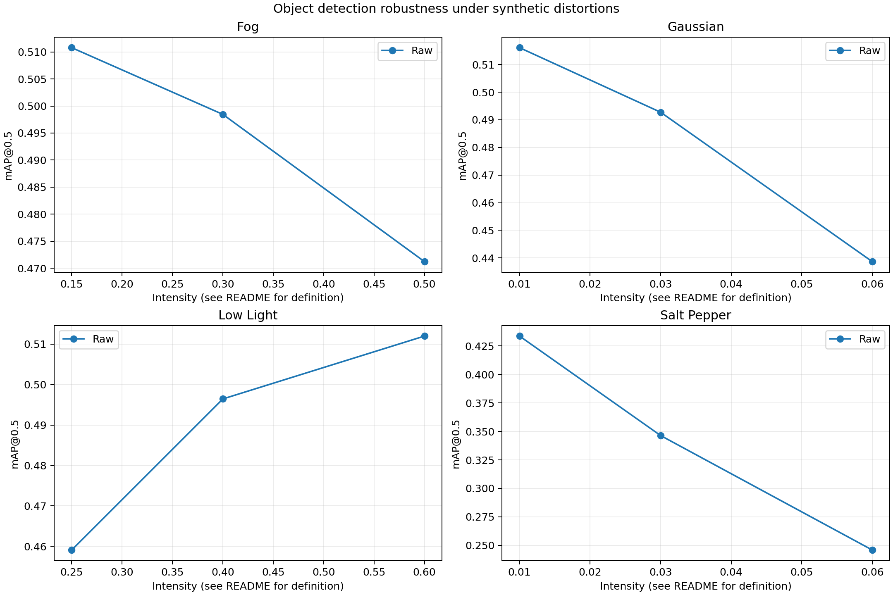

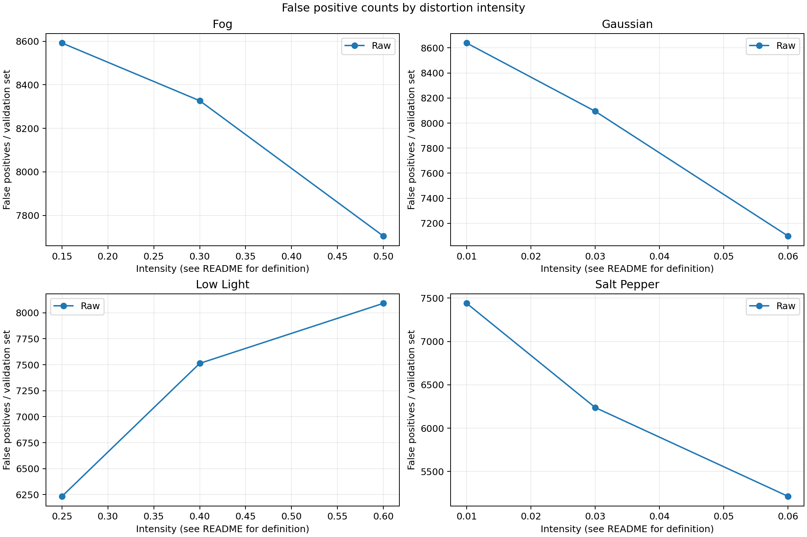

Đường xu hướng trên toàn bộ split nhất quán với subset: Salt-and-Pepper gây hại lớn nhất; mAP@0.5 giảm từ 0.5185 xuống 0.2459 ở mức 0.06. FP cũng giảm khi detector bỏ sót nhiều đối tượng hơn, vì vậy cần đọc chung với FN (clean 18.414; Salt-and-Pepper 0.06 có 27.102). Confusion matrix đầy đủ nằm ở `runs/full_val2017_raw_seed42/confusion_<condition>.png` và `.csv`.

## Recovery trên toàn bộ COCO val2017

Median filter cho Salt-and-Pepper; CLAHE cho fog và low-light. Cùng 5.000 ảnh và nhãn với raw. Gaussian-NLM trên full split chỉ chạy ở level 0.06 do chi phí cao; cả ba level recovery vẫn có trên subset 500 ảnh.

| Biến dạng | Mức | Raw mAP@0.5 | Recovered mAP@0.5 | Δ mAP | FP raw → rec | FN raw → rec |
|---|---:|---:|---:|---:|---:|---:|
| Salt-Pepper | 0.01 | 0.4337 | 0.4997 | +0.0659 | 7440 → 8334 | 21223 → 19188 |
| Salt-Pepper | 0.03 | 0.3464 | 0.4985 | +0.1521 | 6237 → 8255 | 24100 → 19281 |
| Salt-Pepper | 0.06 | 0.2459 | 0.4936 | +0.2478 | 5212 → 8168 | 27102 → 19438 |
| Fog | 0.15 | 0.5108 | 0.5079 | -0.0029 | 8592 → 8615 | 18743 → 18739 |
| Fog | 0.3 | 0.4985 | 0.5072 | +0.0087 | 8327 → 8472 | 19181 → 18842 |
| Fog | 0.5 | 0.4712 | 0.4998 | +0.0286 | 7705 → 8144 | 20339 → 19224 |
| Low-Light | 0.6 | 0.5120 | 0.5087 | -0.0033 | 8091 → 8271 | 18945 → 18969 |
| Low-Light | 0.4 | 0.4965 | 0.5026 | +0.0062 | 7513 → 7872 | 19751 → 19350 |
| Low-Light | 0.25 | 0.4591 | 0.4848 | +0.0257 | 6233 → 7155 | 21338 → 20336 |

NLM tăng Gaussian 0.06 thêm **0.0073** (0.4387 → 0.4460), chỉ phục hồi một phần mức giảm. Median filter tăng mAP@0.5 Salt-and-Pepper 0.06 thêm **0.2478** (0.2459 → 0.4936), làm FN giảm 7.664. CLAHE tăng mAP fog 0.50 thêm 0.0286 và low-light 0.25 thêm 0.0257; ở fog 0.15 và low-light 0.60, mAP giảm nhẹ.

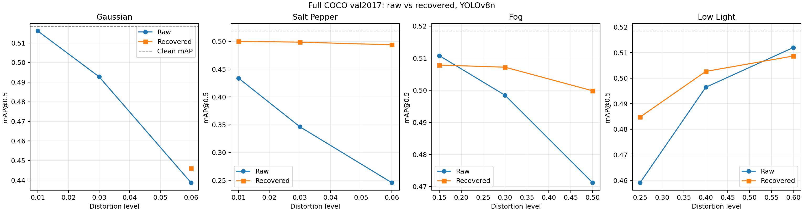

Bảng so sánh đầy đủ: `runs/full_val2017_comparison_seed42/raw_vs_recovered.csv`. Confusion matrices recovered nằm trong `runs/full_val2017_recovered_seed42/`.

## Thiết lập subset 500 ảnh — ba seed, raw và recovered

| Thuộc tính | Giá trị |
|---|---|
| Dataset | COCO 2017 val, subset cố định 500 ảnh, ba seed nhiễu 42, 43, 44; 3.799 instances; 79/80 lớp có ground truth |
| Detector | YOLOv8n, checkpoint pretrained COCO `yolov8n.pt`, không fine-tune |
| Framework | Ultralytics 8.4.204; PyTorch 2.10.0+cu128; CUDA 12.8 |
| GPU | NVIDIA GeForce RTX 3060 12 GB |
| Input / batch | 640 / 16 |
| Đếm FP/FN | confidence 0.25, ghép greedy IoU 0.5 |
| Baseline clean | mAP@0.5 0.5440; mAP@0.5:0.95 0.3894; TP 1.896; FP 894; FN 1.903 |

Phép đo Ultralytics mAP dùng thiết lập validation của thư viện; confidence 0.25 ở trên chỉ áp dụng cho confusion counts, không phải ngưỡng tính mAP.

## Biến dạng và tiền xử lý

Gaussian cộng nhiễu chuẩn với sigma = level × 255 (0.01, 0.03, 0.06). Salt-and-Pepper thay ngẫu nhiên tỷ lệ pixel 0.01, 0.03, 0.06 thành đen/trắng. Fog trộn ảnh với màu xám sáng 235 theo alpha 0.15, 0.30, 0.50. Low-light nhân độ sáng với 0.60, 0.40, 0.25 rồi áp gamma 1.15; hệ số thấp hơn nghĩa là tối hơn. Raw và recovered được tạo từ cùng ảnh và seed.

Recovery tự động dùng Fast Non-Local Means cho Gaussian, median 3×3 cho Salt-and-Pepper, và CLAHE trên kênh L của Lab cho fog/low-light.

## Kết quả mAP@0.5 — trung bình qua ba seed

| Biến dạng | Mức | Raw (mean ± SD) | Recovered (mean ± SD) | Δ recovery |
|---|---:|---:|---:|---:|
| Clean | 0 | 0.5440 ± 0.0000 | — | — |
| Gaussian | 0.01 | 0.5434 ± 0.0026 | 0.5171 ± 0.0019 | -0.0263 |
| Gaussian | 0.03 | 0.5213 ± 0.0059 | 0.5084 ± 0.0015 | -0.0129 |
| Gaussian | 0.06 | 0.4607 ± 0.0023 | 0.4672 ± 0.0048 | +0.0064 |
| Salt-Pepper | 0.01 | 0.4617 ± 0.0002 | 0.5259 ± 0.0044 | +0.0642 |
| Salt-Pepper | 0.03 | 0.3693 ± 0.0020 | 0.5180 ± 0.0031 | +0.1487 |
| Salt-Pepper | 0.06 | 0.2692 ± 0.0080 | 0.5169 ± 0.0034 | +0.2476 |
| Fog | 0.15 | 0.5346 ± 0.0000 | 0.5261 ± 0.0000 | -0.0085 |
| Fog | 0.3 | 0.5266 ± 0.0000 | 0.5310 ± 0.0000 | +0.0044 |
| Fog | 0.5 | 0.4928 ± 0.0000 | 0.5228 ± 0.0000 | +0.0300 |
| Low-Light | 0.25 | 0.4798 ± 0.0000 | 0.5105 ± 0.0000 | +0.0308 |
| Low-Light | 0.4 | 0.5260 ± 0.0000 | 0.5283 ± 0.0000 | +0.0023 |
| Low-Light | 0.6 | 0.5425 ± 0.0000 | 0.5331 ± 0.0000 | -0.0094 |

Độ lệch chuẩn là độ lệch mẫu giữa ba seed tạo nhiễu trên cùng subset cố định. Gaussian và Salt-and-Pepper có SD mAP tối đa khoảng 0.0080; fog và low-light là phép biến đổi tất định nên SD bằng 0 và không đại diện cho độ bất định theo ảnh. Ba mẫu noise vẫn chỉ là bằng chứng sơ bộ.

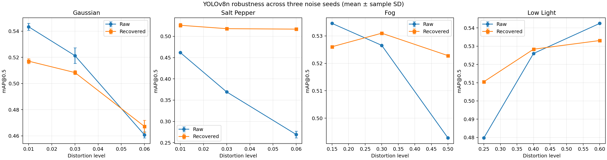

Các trục được tách theo loại biến dạng; level low-light thấp hơn nghĩa là tối hơn.

### Độ nhạy theo lựa chọn ảnh — ba subset COCO rời nhau

Để đo thêm biến thiên do chọn ảnh, chạy 9 điều kiện đại diện trên hai subset 500 ảnh mới, không giao nhau với subset gốc hoặc nhau. Mỗi subset dùng YOLOv8n imgsz 640, batch 16 và noise seed 42; vì vậy khác biệt giữa subset phản ánh chủ yếu thành phần ảnh, không phải đổi seed noise. Bảng là mean ± sample SD qua ba subset; mức thay đổi tương đối được tính so với clean trong cùng subset trước khi tổng hợp.

| Điều kiện | mAP@0.5 qua 3 subset | Δ tương đối so clean (%) |
|---|---:|---:|
| Clean | 0.5413 ± 0.0256 | 0.0 ± 0.0 |
| Gaussian 0.06 raw | 0.4616 ± 0.0175 | -14.7 ± 0.9 |
| Gaussian 0.06 NLM | 0.4705 ± 0.0180 | -13.0 ± 1.5 |
| Salt-and-Pepper 0.06 raw | 0.2674 ± 0.0120 | -50.6 ± 1.2 |
| Salt-and-Pepper 0.06 median | 0.5185 ± 0.0283 | -4.2 ± 0.7 |
| Fog 0.50 raw | 0.4994 ± 0.0193 | -7.7 ± 1.8 |
| Fog 0.50 CLAHE | 0.5249 ± 0.0201 | -3.0 ± 1.2 |
| Low-light 0.25 raw | 0.4812 ± 0.0183 | -11.1 ± 1.1 |
| Low-light 0.25 CLAHE | 0.5095 ± 0.0230 | -5.9 ± 0.3 |

Salt-and-Pepper vẫn gây suy giảm lớn nhất và median phục hồi mạnh trên cả ba nhóm ảnh. Độ lệch chuẩn giữa subset tương đối lớn hơn noise-seed SD trước đó, đặc biệt với clean và recovered; đây là bằng chứng rằng lựa chọn ảnh ảnh hưởng đáng kể tới mAP. Ba subset vẫn chỉ lấy từ cùng COCO val2017 và không thay thế test benchmark độc lập.

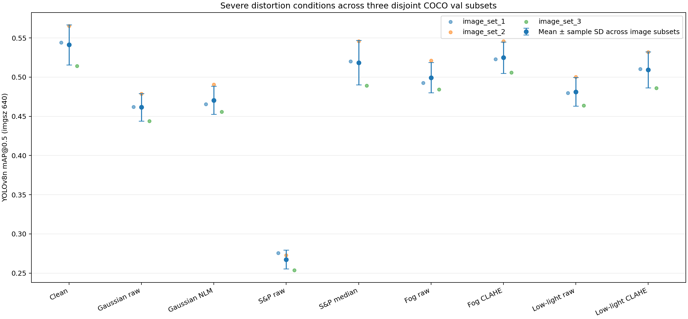

Metrics từng subset và summary: `runs/image_subset_analysis/metrics_by_image_subset.csv`, `metrics_summary_by_image_subset.csv`. Tái tạo bằng `aggregate_image_subsets.py`; manifests subset nằm trong `datasets/coco/subset_500*`.

### Recall theo kích thước vật thể — subset COCO 500 ảnh

Đo recall class-aware theo diện tích bbox COCO: small <32² px, medium 32²–96² px, large ≥96² px. Dùng cùng subset và YOLOv8n-640; prediction chỉ tính TP khi confidence ≥0.25 và IoU ≥0.5. Ghép một-một theo lớp được thực hiện một lần mỗi ảnh trước khi nhóm TP theo kích thước.

| Điều kiện | Small (1.157 GT) | Medium (1.386 GT) | Large (1.256 GT) |
|---|---:|---:|---:|
| Clean | 0.2239 | 0.5354 | 0.7325 |
| Gaussian 0.06 raw | 0.1634 | 0.4315 | 0.6338 |
| Gaussian 0.06 NLM | 0.1677 | 0.4423 | 0.6545 |
| S&P 0.06 raw | 0.1132 | 0.2734 | 0.3846 |
| S&P 0.06 median | 0.1677 | 0.4820 | 0.7309 |
| Fog 0.50 raw | 0.1746 | 0.4632 | 0.6624 |
| Fog 0.50 CLAHE | 0.2014 | 0.4964 | 0.7062 |
| Low-light 0.25 raw | 0.1461 | 0.4156 | 0.6497 |
| Low-light 0.25 CLAHE | 0.1711 | 0.4596 | 0.6744 |

Object nhỏ có recall thấp nhất ở mọi điều kiện; S&P 0.06 raw gây recall thấp nhất ở cả ba nhóm kích thước. Suy giảm tương đối so với clean lớn hơn ở object nhỏ với Gaussian, fog và low-light. Median phục hồi đáng kể recall của S&P, còn NLM/CLAHE cho mức tăng khiêm tốn hơn ở các cường độ nặng này. Bảng chỉ phản ánh một subset, một seed và một ngưỡng confidence; nó bổ sung cho mAP chứ không thay thế mAP.

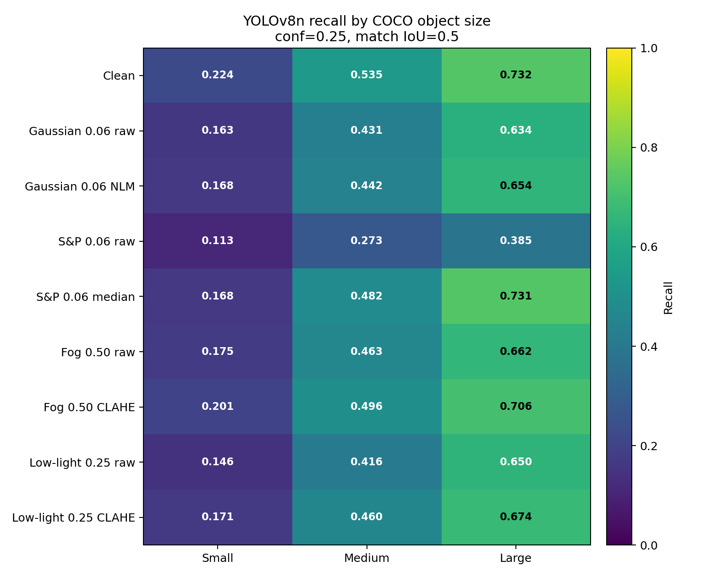

Metrics TP/FN/support theo seed: `runs/size_stratified_analysis/size_stratified_recall_by_seed.csv`; summary: `size_stratified_recall.csv`. Tái tạo bằng `python analyze_size_robustness.py`.

### Độ nhạy size theo seed nhiễu — ba lần lặp

Lặp clean, Gaussian 0.06 raw/NLM và S&P 0.06 raw/median với seed 42/43/44 trên cùng 500 ảnh. Bảng là mean ± SD mẫu của recall theo size; clean bất biến nên SD=0.

| Điều kiện | Small recall | Medium recall | Large recall |
|---|---:|---:|---:|
| Clean | 0.2239 ± 0.0000 | 0.5354 ± 0.0000 | 0.7325 ± 0.0000 |
| Gaussian 0.06 raw | 0.1625 ± 0.0023 | 0.4264 ± 0.0059 | 0.6356 ± 0.0047 |
| Gaussian 0.06 NLM | 0.1677 ± 0.0052 | 0.4396 ± 0.0052 | 0.6526 ± 0.0032 |
| S&P 0.06 raw | 0.1066 ± 0.0061 | 0.2732 ± 0.0004 | 0.3854 ± 0.0014 |
| S&P 0.06 median | 0.1726 ± 0.0043 | 0.4803 ± 0.0015 | 0.7320 ± 0.0009 |

Thứ tự độ nhạy và hiệu quả recovery giữ ổn định qua ba seed. SD đo biến thiên của mẫu nhiễu trên cùng ảnh, không phải bất định do chọn ảnh; các recall này vẫn là threshold metrics tại confidence 0.25/IoU 0.5.

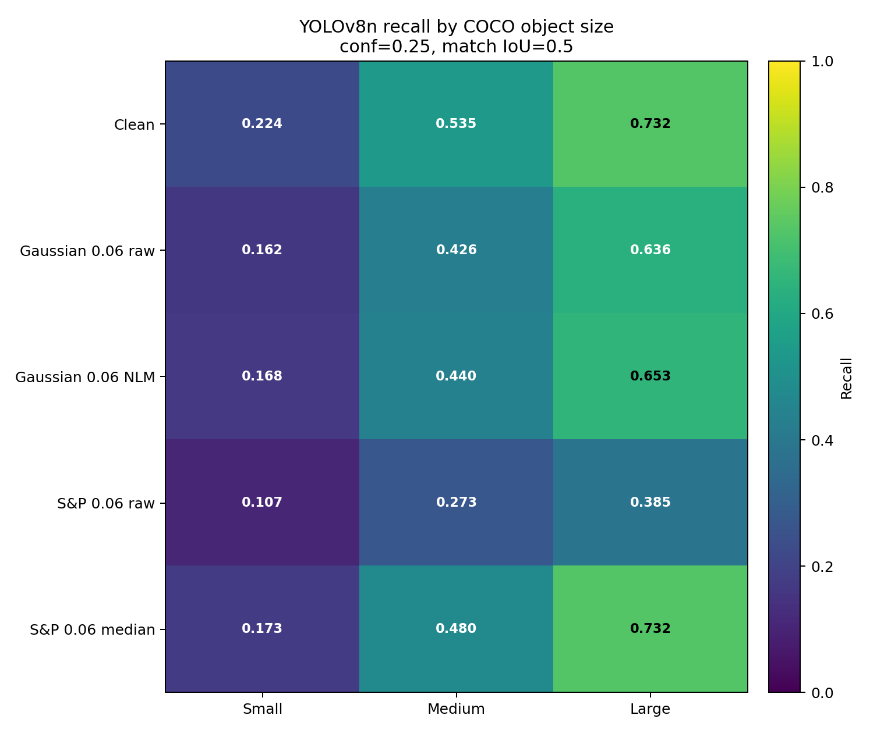

Từng seed và TP/FN/support: `runs/size_stratified_seed_analysis/size_stratified_recall_by_seed.csv`; summary: `size_stratified_recall.csv`. Tái tạo bằng `python analyze_size_robustness.py --seeds 42 43 44 --conditions clean gaussian_0.06 gaussian_0.06_recovered salt_pepper_0.06 salt_pepper_0.06_recovered --out runs/size_stratified_seed_analysis`.

### Kiểm tra độ nhạy theo tập ảnh — recall theo kích thước

Lặp lại đủ 9 điều kiện trên ba subset COCO rời nhau, mỗi subset 500 ảnh; cùng YOLOv8n-640, confidence 0.25, IoU ghép 0.5 và seed biến dạng 42. Bảng là mean ± SD giữa ba subset (SD đo biến thiên do chọn ảnh). Recall S&P raw vẫn thấp nhất; median nâng recall lớn gần mức clean ở cả ba tập. Mẫu hình phục hồi fog và low-light cũng giữ nguyên, dù độ lớn thay đổi theo subset.

| Điều kiện | Small | Medium | Large |
|---|---:|---:|---:|
| Clean | 0.212 ± 0.011 | 0.520 ± 0.026 | 0.741 ± 0.012 |
| Gaussian 0.06 raw | 0.148 ± 0.013 | 0.411 ± 0.023 | 0.642 ± 0.015 |
| Gaussian 0.06 NLM | 0.151 ± 0.014 | 0.419 ± 0.033 | 0.668 ± 0.011 |
| S&P 0.06 raw | 0.098 ± 0.014 | 0.267 ± 0.009 | 0.389 ± 0.004 |
| S&P 0.06 median | 0.168 ± 0.009 | 0.481 ± 0.012 | 0.736 ± 0.009 |
| Fog 0.50 raw | 0.168 ± 0.006 | 0.461 ± 0.019 | 0.672 ± 0.010 |
| Fog 0.50 CLAHE | 0.188 ± 0.011 | 0.495 ± 0.023 | 0.717 ± 0.012 |
| Low-light 0.25 raw | 0.135 ± 0.009 | 0.420 ± 0.013 | 0.660 ± 0.009 |
| Low-light 0.25 CLAHE | 0.163 ± 0.007 | 0.450 ± 0.015 | 0.692 ± 0.017 |

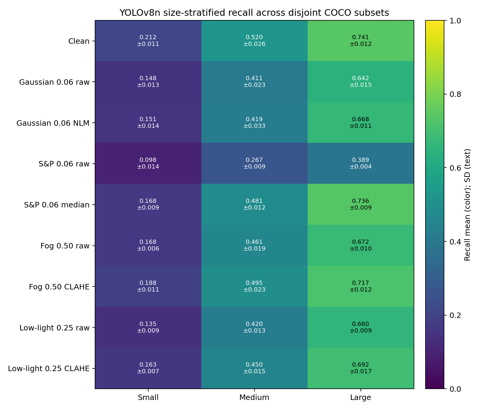

CSV chi tiết theo subset và summary: `runs/size_stratified_subsets/`. Tái tạo bằng `python analyze_size_across_subsets.py`. Đây là độ lệch giữa ba subset trong cùng COCO val2017, không phải ba dataset benchmark độc lập.

### Lỗi theo lớp qua ba subset COCO

Để xem xu hướng S&P có tập trung vào một số lớp hay không, tổng hợp confusion matrices clean, S&P 0.06 raw và median từ ba subset. Hạng lớp dựa trên mức giảm recall trung bình theo từng subset; chỉ đưa vào xếp hạng các lớp có ít nhất 30 ground-truth instances cộng gộp. Cat, mouse, airplane và refrigerator có mức giảm recall raw trung bình lần lượt **−73.5, −73.1, −70.7 và −67.1 điểm phần trăm**. Sau median, các mức giảm còn **−12.5, −5.4, −2.7 và −3.3 điểm**. Đây là các lớp có support thấp hơn nhiều lớp phổ biến nên đọc như thống kê mô tả, không phải bằng chứng kiểm định cho từng lớp.

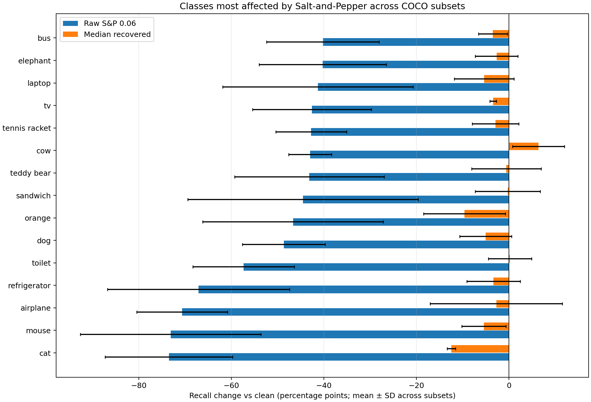

Bảng counts theo subset, delta per-subset và summary per-class nằm trong `runs/classwise_subset_analysis/`; tái tạo bằng `python analyze_class_errors_subsets.py`. Error bars là SD giữa ba subset.

### So sánh lỗi theo lớp giữa bốn họ biến dạng

Mở rộng cùng phép đo sang Gaussian 0.06, fog 0.50 và low-light 0.25. Mỗi số là thay đổi recall so với clean trong từng subset, sau đó lấy trung bình và SD giữa ba subset. Trong các lớp đủ 30 nhãn cộng gộp, lớp có mức giảm raw lớn nhất theo mỗi họ là mouse với Gaussian (**−31.7 ± 7.5 pp**), cat với S&P (**−73.5 ± 13.8 pp**), oven với fog (**−27.0 ± 13.8 pp**) và frisbee với low-light (**−25.9 ± 10.2 pp**). Recovery giảm mức suy giảm ở các ví dụ này; riêng Gaussian NLM vẫn để mouse thấp hơn clean 20.2 pp, trong khi CLAHE đưa frisbee dưới low-light lên còn −3.7 pp. Kết quả giữa lớp biến động đáng kể và support thấp, nên chỉ dùng để mô tả khác biệt theo lớp.

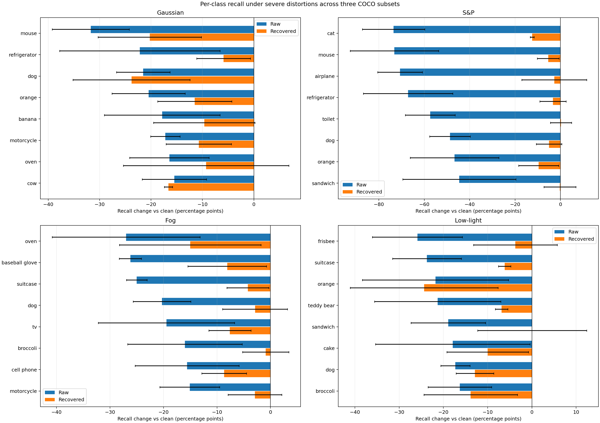

Metrics chi tiết theo lớp/subset và summary mean ± SD: `runs/classwise_all_conditions_subsets/`; tái tạo bằng `python analyze_all_class_errors_subsets.py`. Biểu đồ hiển thị tám lớp bị giảm recall nhiều nhất ở raw trong mỗi họ (các lớp có support clean cộng gộp ≥30); thanh lỗi là SD giữa subset.

### Trường hợp recovery làm recall theo lớp xấu đi

So sánh trực tiếp recovered − raw cho thấy NLM/CLAHE không có lợi ích đồng đều cho mọi lớp. Dưới đây là lớp có mức giảm recovery trung bình rõ nhất trong từng họ, tính trên ba subset; Δ là thay đổi recall so với clean, còn lợi ích recovery = recovered − raw.

| Họ nhiễu | Lớp | GT gộp | Raw Δ recall (pp) | Recovered Δ recall (pp) | Lợi ích recovery (pp) |
|---|---|---:|---:|---:|---:|
| Gaussian / NLM | teddy bear | 45 | −11.3 | −21.3 | −10.0 |
| S&P / median | handbag | 144 | −10.5 | −4.2 | +6.3 |
| Fog / CLAHE | carrot | 88 | +2.9 | −4.2 | −7.1 |
| Low-light / CLAHE | cow | 84 | −8.4 | −12.3 | −3.9 |

Trong các lớp có support ≥30, median cải thiện recall trung bình ở mọi lớp của S&P; ngược lại có một số lớp Gaussian/fog/low-light mà recovery làm recall giảm so với raw. Giá trị positive/negative nhỏ có thể phản ánh nhiễu lấy mẫu hoặc tương tác ảnh-lớp, nên không nên dùng để điều chỉnh riêng từng lớp từ validation này. Bảng lợi ích recovery cho từng lớp: `runs/classwise_all_conditions_subsets/classwise_recovery_effect_summary.csv`.

## False positive và confusion matrix

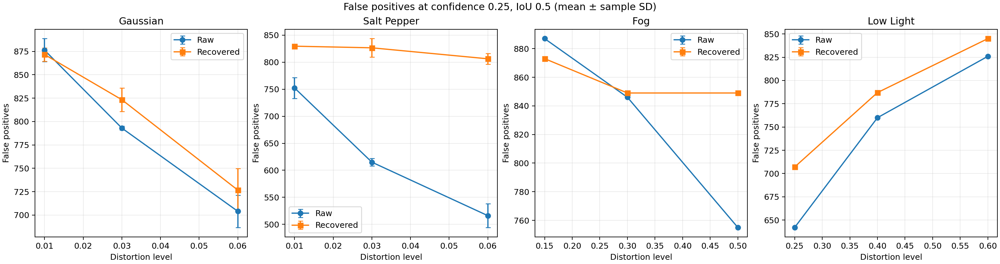

FP (trung bình qua ba seed) không tăng tuyến tính cùng cường độ. Với ngưỡng confidence 0.25 và IoU 0.5, clean có 894 FP; raw ở mức biến dạng cao nhất có trung bình Gaussian 704, Salt-and-Pepper 516, fog 755, low-light 642. Điều này xảy ra đồng thời với việc số TP giảm và FN tăng, nên không thể kết luận detector tốt hơn chỉ từ FP thấp; mAP, recall và FN cần được xem cùng nhau. Confusion matrix và các bộ đếm đầy đủ nằm trong thư mục kết quả.

Để kiểm tra ảnh hưởng của ngưỡng, đánh giá lại clean cùng bốn biến dạng nặng raw/recovered trên ba subset COCO, tại confidence 0.05, 0.25, 0.50 và IoU match 0.5. Bảng dưới ghi FP/FN trung bình trên 100 ảnh cho S&P; các con số là trung bình giữa ba subset.

| Confidence | Clean FP / FN | S&P raw FP / FN | S&P median FP / FN |
|---:|---:|---:|---:|
| 0.05 | 1,200.4 / 260.3 | 772.9 / 466.7 | 1,096.3 / 281.8 |
| 0.25 | 180.1 / 378.9 | 101.5 / 556.6 | 166.3 / 399.9 |
| 0.50 | 41.9 / 478.4 | 23.4 / 620.5 | 39.3 / 494.7 |

S&P raw có ít FP hơn clean ở cả ba ngưỡng, nhưng FN cao hơn rõ rệt vì detector bỏ sót nhiều object. Median đưa cả FP và FN gần baseline hơn; do đó, trong thí nghiệm này không thấy hiện tượng FP tăng do nhiễu, mà thấy trade-off FP/FN phụ thuộc ngưỡng và suy giảm recall. Đường FP/FN cho cả bốn họ biến dạng: `runs/confidence_threshold_analysis/fp_fn_by_confidence_threshold.png`; CSV theo subset và summary ở cùng thư mục. Tái tạo bằng `python analyze_confidence_threshold_sensitivity.py`.

Một số confusion matrix để xem nhanh:

- Clean: `runs/noise_sweep_seed42/confusion_clean.png`
- Salt-and-Pepper 0.06 raw / recovered: `runs/noise_sweep_seed42/confusion_salt_pepper_0.06.png`, `runs/noise_sweep_seed42/confusion_salt_pepper_0.06_recovered.png`
- Gaussian 0.06 raw / recovered: `runs/noise_sweep_seed42/confusion_gaussian_0.06.png`, `runs/noise_sweep_seed42/confusion_gaussian_0.06_recovered.png`
- Fog 0.50 raw / recovered: `runs/noise_sweep_seed42/confusion_fog_0.5.png`, `runs/noise_sweep_seed42/confusion_fog_0.5_recovered.png`
- Low-light 0.25 raw / recovered: `runs/noise_sweep_seed42/confusion_low_light_0.25.png`, `runs/noise_sweep_seed42/confusion_low_light_0.25_recovered.png`

## Phân tích lỗi theo lớp — full val2017

Từ confusion matrix 80×80 với background, tính TP/FP/FN theo từng lớp tại confidence 0.25 và IoU 0.5. Ở Salt-and-Pepper 0.06, số FP tăng nhiều nhất ở bench (+129; support 411), umbrella (+113; 407), tie (+111; 252), surfboard (+81; 267). Đọc số đếm cùng support.

Số FN của person tăng nhiều nhất (+2.178 trên 10.777 ground-truth instances), dù FP person giảm 633: nhiều đối tượng person bị bỏ sót thay vì bị phát hiện sai thành lớp khác. Đây là lý do FP tổng có thể giảm trong khi chất lượng detector xấu đi.

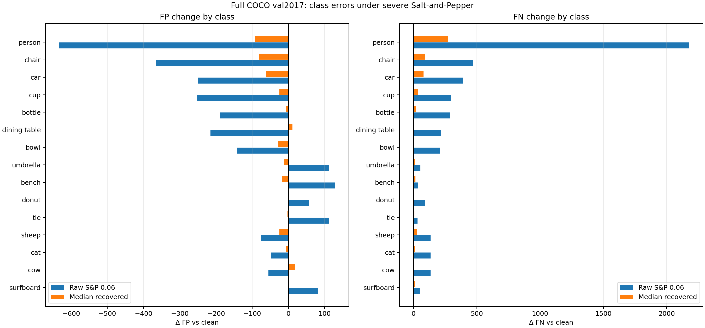

Bảng metrics đầy đủ theo lớp/điều kiện: `runs/full_val2017_classwise/classwise_confusion_metrics.csv`; thay đổi so với clean: `classwise_deltas_vs_clean.csv`. Tạo lại bằng `analyze_class_errors.py`.

## Thảo luận và kết luận

Trong thiết lập này, detector nhạy nhất với Salt-and-Pepper: mAP suy giảm gần một nửa tương đối ở mức 0.06. Median filter phục hồi gần mức clean trên cả ba cường độ. CLAHE cải thiện fog nặng và ảnh tối nhất, nhưng làm giảm mAP ở fog/low-light nhẹ. NLM với tham số hiện tại làm giảm mAP ở Gaussian nhẹ-vừa, nên cần thử mức lọc nhẹ hơn hoặc so sánh với bilateral/no denoising trước khi kết luận về Gaussian.

Đây là kết quả thăm dò, không phải benchmark COCO chính thức. Ba seed noise đầy đủ được đo trên một subset; 9 điều kiện nặng được đo thêm trên ba subset COCO rời nhau. Các subset không phải benchmark độc lập và không thay thế test split riêng. Fog là veil đồng nhất không dùng depth; low-light là biến đổi tổng hợp. Detector không được fine-tune trong thí nghiệm này.

## Tệp kết quả

- Full val2017 raw, đủ 13 điều kiện: `runs/full_val2017_raw_seed42/metrics.csv`
- Biểu đồ và confusion matrix raw full val: `runs/full_val2017_raw_seed42/`
- Recovery full val: `runs/full_val2017_recovered_seed42/metrics.csv` và `runs/full_val2017_gaussian_recovered_seed42/metrics.csv`
- Bảng/graf raw vs recovered: `runs/full_val2017_comparison_seed42/raw_vs_recovered.csv`, `map_raw_vs_recovered.png`
- Phân tích confusion theo lớp: `runs/full_val2017_classwise/`
- Script tạo bảng gộp: `aggregate_full_val.py`; script thống kê seed: `aggregate_repeats.py`
- Nhật ký lệnh, cấu hình và ghi chú: `EXPERIMENT_LOG.md`

- Bảng đầy đủ 25 điều kiện: `runs/noise_sweep_seed42/metrics.csv`, `runs/repeat_seed43/metrics.csv`, `runs/repeat_seed44/metrics.csv`
- Đường cong mAP mean ± SD: `runs/repeat_analysis_seed42_43_44/map_vs_intensity_mean_std.png`
- Bảng theo seed và thống kê tổng hợp: `runs/repeat_analysis_seed42_43_44/metrics_by_seed.csv`, `metrics_summary.csv`
- FP mean ± SD: `runs/repeat_analysis_seed42_43_44/false_positives_mean_std.png`
- Confusion matrices: `runs/noise_sweep_seed42/confusion_<condition>.png` và `.csv`
- Phân tích 9 điều kiện nặng trên ba subset rời nhau: `runs/image_subset_analysis/`

## So sánh YOLOv8n và SSDLite trên COCO val2017 đầy đủ

Đánh giá thêm torchvision SSDLite320-MobileNetV3-Large với trọng số COCO pretrained trên cùng 5.000 ảnh, cùng nhãn YOLO đã chuyển đổi và cùng các ảnh raw/recovered. Bảng dưới đây tập trung vào mức mạnh nhất đã chọn cho từng họ nhiễu. Δ là thay đổi tuyệt đối so với baseline clean riêng của từng model.

| Biến dạng | YOLO raw | YOLO recovered | Δ YOLO | SSDLite raw | SSDLite recovered | Δ SSDLite |
|---|---:|---:|---:|---:|---:|---:|
| Clean baseline | 0.5185 | — | — | 0.3386 | — | — |
| Gaussian 0.06 | 0.4387 | 0.4460 | +0.0073 | 0.3184 | 0.3065 | -0.0119 |
| Salt-and-Pepper 0.06 | 0.2459 | 0.4936 | +0.2478 | 0.2254 | 0.3298 | +0.1044 |
| Fog 0.50 | 0.4712 | 0.4998 | +0.0286 | 0.3005 | 0.3223 | +0.0218 |
| Low-light 0.25 | 0.4591 | 0.4848 | +0.0257 | 0.2872 | 0.3050 | +0.0179 |

Các giá trị trong bảng là mAP@0.5. Với SSDLite, Salt-and-Pepper raw làm mAP giảm tương đối 33.4% so với baseline; median filter phục hồi +0.1044 mAP nhưng vẫn thấp hơn baseline 0.0088. Gaussian-NLM làm SSDLite giảm thêm 0.0119 so với ảnh Gaussian raw, trong khi YOLO tăng nhẹ 0.0073. CLAHE cải thiện fog nặng và low-light tối nhất ở cả hai detector. Tại ngưỡng confusion cố định 0.25/IoU 0.5, SSDLite baseline có FP 6.933 và FN 25.297; S&P raw có FP 6.392, FN 28.301, nên FP giảm không có nghĩa là detector tốt hơn khi FN tăng mạnh.

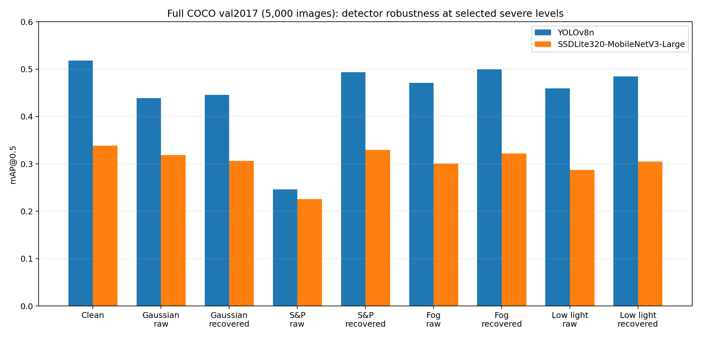

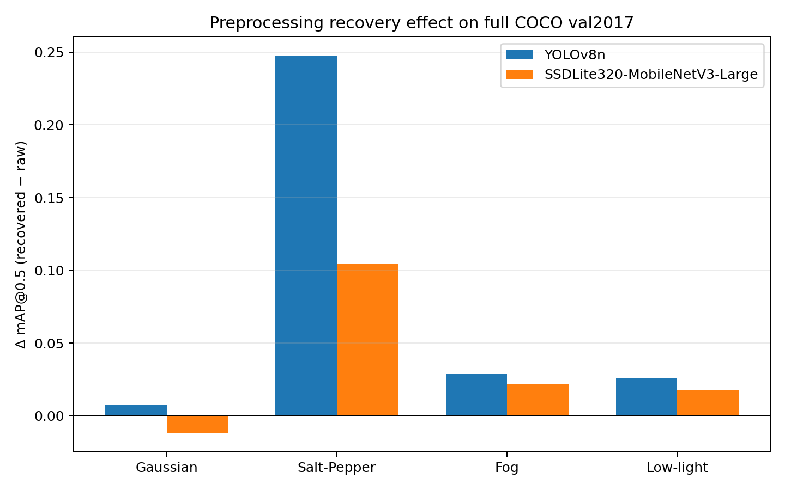

Bảng đầy đủ gồm 9 điều kiện × 2 model và các số FP/FN: `runs/detector_comparison_fullval/metrics.csv`. Có thể tái tạo bằng `compare_detectors.py`.

**Lưu ý so sánh:** YOLOv8n dùng pipeline Ultralytics ở imgsz 640; SSDLite dùng transform chuẩn của trọng số torchvision với đầu vào 320. SSDLite AP được tính bằng script riêng theo nội suy 101 điểm trên IoU 0.50–0.95; YOLO AP lấy từ validator Ultralytics. Cả hai dùng cùng tập ảnh, ground truth COCO đã loại crowd và cùng ánh xạ 80 lớp theo tên, nhưng khác pipeline, kích thước đầu vào và chi tiết triển khai AP/NMS. Do đó nên diễn giải xu hướng raw/recovered bên trong từng model chắc chắn hơn chênh lệch tuyệt đối giữa hai model; đây chưa phải so sánh benchmark đã chuẩn hóa hoàn toàn.

### Sai số SSDLite theo lớp

Ở Salt-and-Pepper 0.06 raw so với clean, FP theo lớp của SSDLite tăng nhiều nhất ở bench (+167), teddy bear (+134), person (+126), cake (+99) và train (+86). FN person tăng 546 trên tổng support 10.777; vì vậy detector vừa tạo thêm một số dự đoán sai ở person, vừa bỏ sót người nhiều hơn đáng kể. Sau median filter, person FN delta giảm từ +546 xuống +73 so với clean.

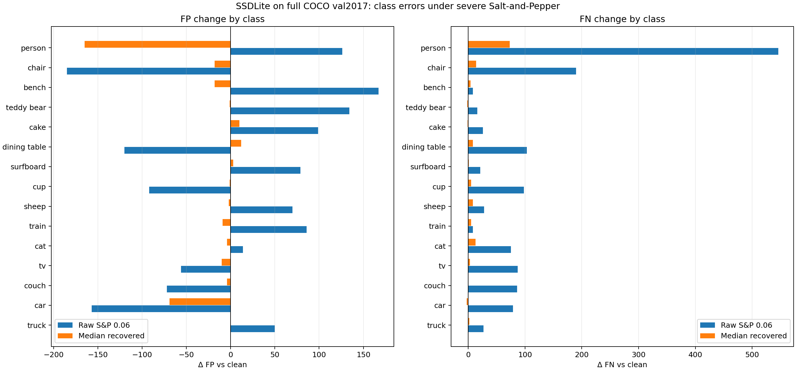

Metrics per-class cho cả 9 điều kiện: `runs/ssdlite_fullval_seed42/classwise/classwise_confusion_metrics.csv`; delta so clean: `classwise_deltas_vs_clean.csv`. Tái tạo bằng `analyze_ssdlite_class_errors.py`.

Phân tích class-wise chuẩn hóa cùng evaluator/input 320 cho hai model: ở S&P 0.06 raw, YOLO tăng FN person +938 và chair +220; SSDLite tăng FN person +546 và chair +190 (support lần lượt 10.777 và 1.771). Median recovery đưa person FN delta về +91 cho YOLO và +73 cho SSDLite. FP tăng khác nhau theo kiến trúc: YOLO tăng mạnh nhất ở teddy bear (+82) và sheep (+79), còn SSDLite ở bench (+167), teddy bear (+134) và person (+126). Đây là count tại conf 0.25/IoU 0.5; các mức support là tổng GT instances, nên không thay thế recall/AP.

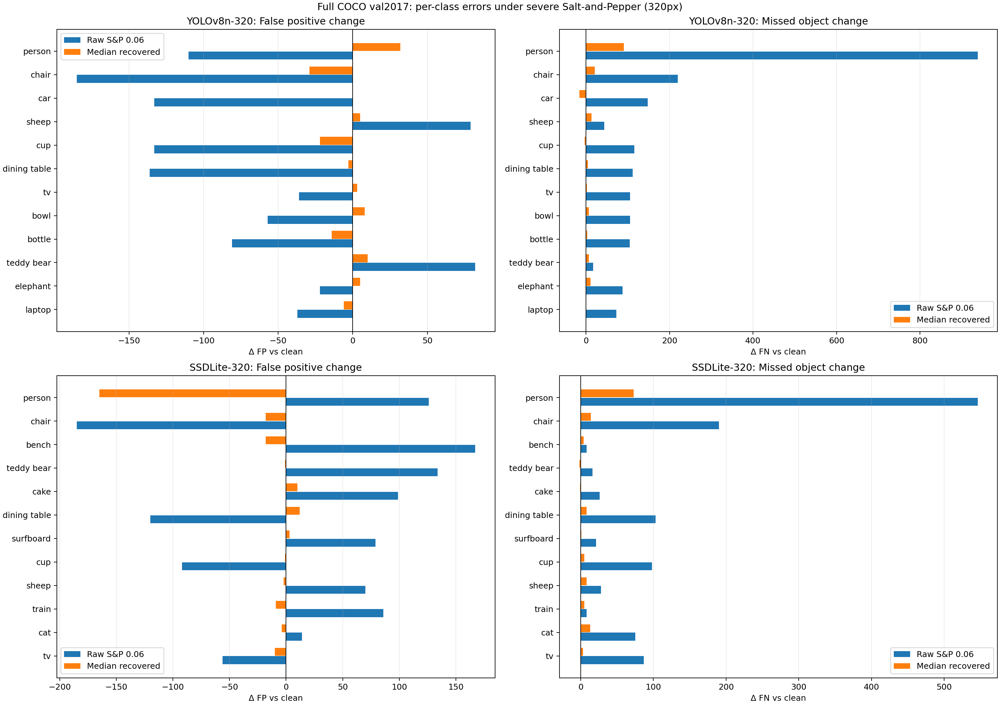

CSV per-class trên các điều kiện chung và delta so clean nằm trong `runs/normalized_detector_comparison_fullval/classwise/`; tái tạo bằng `analyze_normalized_class_errors.py`.

Chuẩn hóa theo support cho thấy S&P 0.06 làm recall tại conf 0.25 giảm mạnh nhất ở refrigerator (−42.1 điểm phần trăm), mouse (−39.6) và microwave (−38.2) với YOLO; ở cat (−37.1), airplane (−35.0) và refrigerator (−34.9) với SSDLite. Median filter đưa refrigerator về recall clean ở cả hai model; mouse ở YOLO cao hơn clean 0.9 điểm, trong khi cat ở SSDLite còn thấp hơn clean 6.4 điểm. Một số lớp có support nhỏ, vì vậy các chênh lệch này là mô tả trên COCO val2017, không phải kiểm định thống kê độc lập.

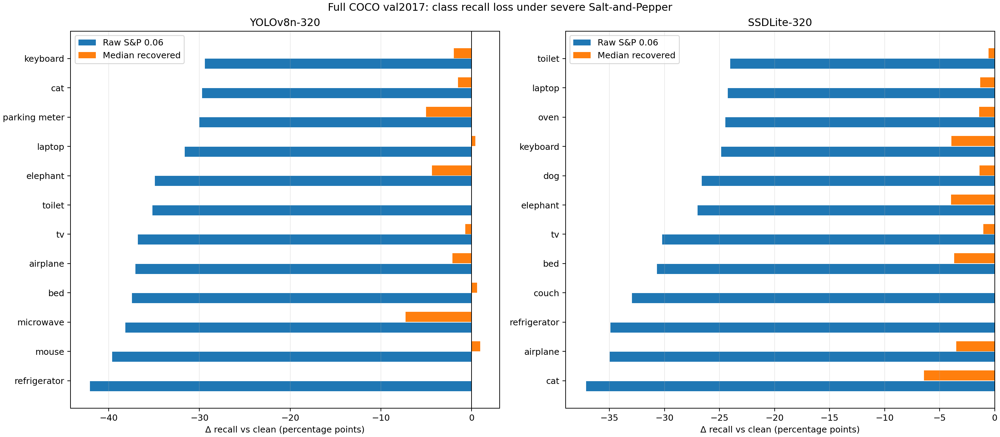

## So sánh chuẩn hóa: cùng input 320 và cùng cách tính AP

Để giảm sai khác giữa hai giao thức trước đó, YOLOv8n được chạy lại ở imgsz 320 và AP được tính bằng cùng evaluator nội suy 101 điểm, IoU 0.50–0.95 như SSDLite. Cùng 5.000 ảnh/nhãn COCO val2017; confusion counts ở conf 0.25, IoU 0.5. Bảng dưới đây là mAP@0.5; phần trăm suy giảm tính riêng trên baseline clean mỗi detector.

| Điều kiện | YOLOv8n-320 | Δ so clean | SSDLite-320 | Δ so clean |
|---|---:|---:|---:|---:|
| Clean | 0.4037 | — | 0.3386 | — |
| Gaussian 0.06 raw | 0.3766 | -6.7% | 0.3184 | -6.0% |
| Gaussian 0.06 recovered | 0.3813 | -5.5% | 0.3065 | -9.5% |
| Salt-and-Pepper 0.06 raw | 0.2612 | -35.3% | 0.2254 | -33.4% |
| Salt-and-Pepper 0.06 recovered | 0.3951 | -2.1% | 0.3298 | -2.6% |
| Fog 0.50 raw | 0.3576 | -11.4% | 0.3005 | -11.3% |
| Fog 0.50 recovered | 0.3859 | -4.4% | 0.3223 | -4.8% |
| Low-light 0.25 raw | 0.3482 | -13.8% | 0.2872 | -15.2% |
| Low-light 0.25 recovered | 0.3728 | -7.6% | 0.3050 | -9.9% |

Kết quả củng cố ba quan sát: (1) Salt-and-Pepper nặng gây suy giảm lớn nhất ở cả hai model; (2) median filter phục hồi phần lớn mAP nhưng chưa chạm baseline clean; (3) CLAHE giúp fog/low-light nặng ở cả hai, còn Gaussian-NLM chỉ cải thiện YOLO nhẹ và làm SSDLite giảm 0.0119 so raw. Ở S&P raw, FP YOLO giảm 5.395→4.051 trong khi FN tăng 23.318→27.299; SSDLite FP 6.933→6.392 trong khi FN tăng 25.297→28.301. Giảm FP đi cùng tăng miss, nên không được xem là cải thiện.

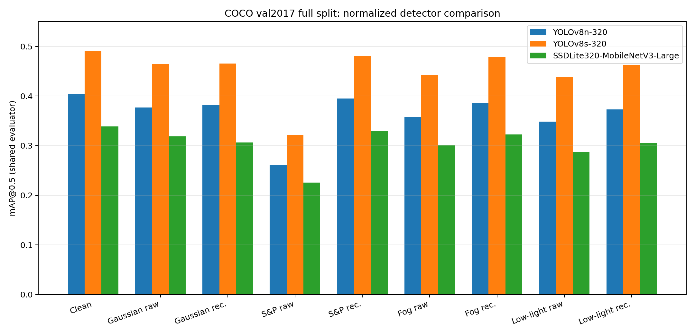

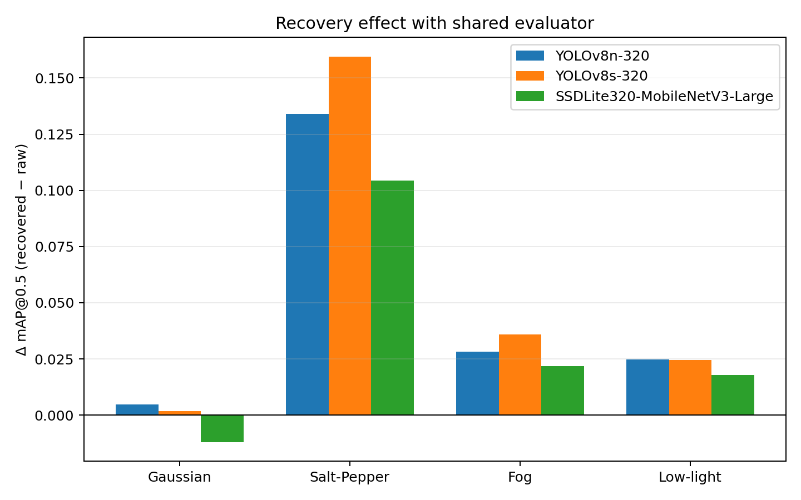

Bảng đủ 18 dòng kèm TP/FP/FN: `runs/normalized_detector_comparison_fullval/metrics.csv`. Kết quả YOLO chạy lại: `runs/yolo_custom_fullval_seed42/metrics.csv`; lệnh tạo lại `python yolo_custom_eval.py --device 0 --imgsz 320 --batch 16`. Tạo bảng/biểu đồ bằng `python compare_detectors_normalized.py`.

So sánh này dùng cùng kích thước mục tiêu và evaluator AP, nhưng vẫn giữ post-processing/NMS mặc định của từng kiến trúc; cách resize nội bộ của model cũng không hoàn toàn giống nhau. Do vậy đây là so sánh được kiểm soát tốt hơn, không phải benchmark hoàn toàn đồng nhất.

### Đường cong raw đầy đủ theo cường độ — cả hai detector

Đã bổ sung 8 mức raw còn thiếu cho cả hai model. Mỗi bộ số theo từng hàng liệt kê mức nhiễu theo thứ tự ghi ở cột đầu; đây là mAP@0.5 trên đủ 5.000 ảnh với evaluator chung.

| Họ biến dạng | Các mức theo thứ tự | YOLOv8n-320 mAP@0.5 | SSDLite-320 mAP@0.5 |
|---|---|---|---|
| Gaussian | 0.01, 0.03, 0.06 | 0.4032, 0.3959, 0.3766 | 0.3391, 0.3330, 0.3184 |
| Salt-and-Pepper | 0.01, 0.03, 0.06 | 0.3663, 0.3179, 0.2612 | 0.2962, 0.2607, 0.2254 |
| Fog | 0.15, 0.30, 0.50 | 0.3990, 0.3852, 0.3576 | 0.3360, 0.3278, 0.3005 |
| Low-light factor† | 0.25, 0.40, 0.60 | 0.3482, 0.3858, 0.3984 | 0.2872, 0.3128, 0.3262 |

Baseline clean: YOLOv8n-320 **0.4037**, SSDLite-320 **0.3386**. Ở mức xấu nhất mỗi họ, suy giảm tương đối so baseline lần lượt là Gaussian 6.7%/6.0%, Salt-and-Pepper 35.3%/33.4%, fog 11.4%/11.3%, và low-light tối nhất 13.8%/15.2% (YOLO/SSDLite). † Low-light factor thấp hơn nghĩa là ảnh tối hơn; vì vậy trục này tăng theo độ sáng chứ không theo độ nặng.

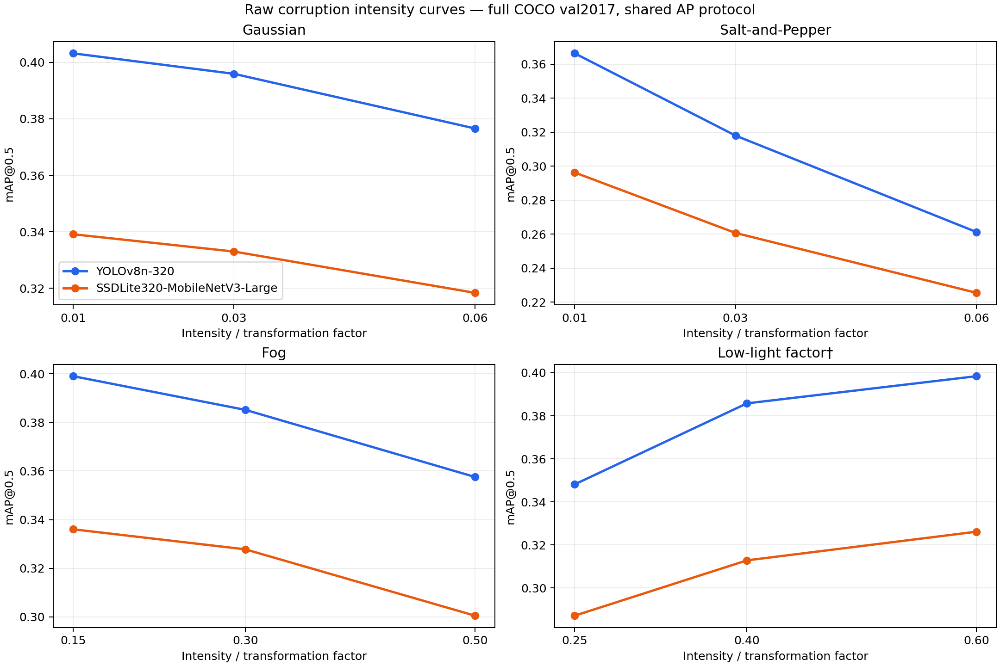

CSV 24 dòng (12 mức × 2 detector), kèm mAP@0.5:0.95 và TP/FP/FN: `runs/normalized_detector_comparison_fullval/raw_intensity_metrics.csv`. Tạo biểu đồ/bảng bằng `plot_detector_intensity_curves.py`.

### Recovery theo cường độ — hai detector, cùng evaluator

Đánh giá bổ sung các nhánh recovered còn thiếu cho SSDLite và chạy lại YOLO trên đúng các ảnh đó. Delta dưới đây là recovered − raw mAP@0.5; mỗi ô ghi YOLOv8n-320 / SSDLite-320.

| Biến dạng | Mức | Δ mAP@0.5 sau recovery (YOLO / SSDLite) |
|---|---:|---:|
| Gaussian-NLM | 0.06 | +0.0047 / -0.0119 |
| Salt-and-Pepper median | 0.01 | +0.0295 / +0.0356 |
| Salt-and-Pepper median | 0.03 | +0.0782 / +0.0705 |
| Salt-and-Pepper median | 0.06 | +0.1339 / +0.1044 |
| Fog-CLAHE | 0.15 | -0.0052 / -0.0019 |
| Fog-CLAHE | 0.30 | +0.0080 / +0.0036 |
| Fog-CLAHE | 0.50 | +0.0283 / +0.0218 |
| Low-light-CLAHE | 0.25 | +0.0247 / +0.0179 |
| Low-light-CLAHE | 0.40 | +0.0045 / +0.0078 |
| Low-light-CLAHE | 0.60 | -0.0053 / +0.0033 |

Median filter cho lợi ích tăng theo cường độ Salt-and-Pepper ở cả hai model. CLAHE hữu ích nhất ở fog nặng và low-light tối; ở mức nhẹ, thay đổi nhỏ hoặc hơi âm. Gaussian-NLM chỉ có full-val ở mức 0.06: nhẹ có lợi cho YOLO nhưng giảm mAP SSDLite. Hai mức Gaussian thấp hơn chưa có ảnh NLM full-val, nên không ngoại suy kết quả này cho toàn đường cong Gaussian.

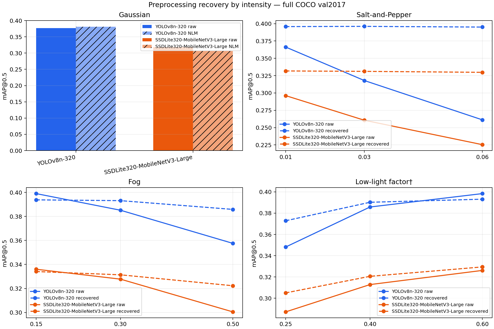

Bảng ghép 20 cặp raw/recovered, gồm cả mAP@0.5:0.95 và FP/FN: `runs/normalized_detector_comparison_fullval/recovery_intensity_metrics.csv`. Tái tạo bằng `plot_recovery_curves.py`. Trước nhánh bilateral, cả hai evaluator có 23 điều kiện (clean, 12 raw, 10 recovered); dưới đây bổ sung thêm ba Gaussian-bilateral condition mỗi model.

### Thử nghiệm Gaussian với bilateral filter

Do Fast Non-Local Means cần hơn một giờ cho mỗi mức Gaussian full-val, bổ sung nhánh bilateral (kernel đường kính 7, sigma màu/không gian 50) ở cả ba mức. Đây là phương pháp riêng, không gộp vào đường NLM. Bảng dùng cùng evaluator ở input 320.

| Model | Gaussian level | Raw mAP@0.5 | Bilateral mAP@0.5 | Δ bilateral − raw | NLM mAP@0.5 (nếu có) |
|---|---:|---:|---:|---:|---:|
| YOLOv8n-320 | 0.01 | 0.4032 | 0.3990 | -0.0041 | — |
| YOLOv8n-320 | 0.03 | 0.3959 | 0.3990 | +0.0031 | — |
| YOLOv8n-320 | 0.06 | 0.3766 | 0.3906 | +0.0140 | 0.3813 |
| SSDLite-320 | 0.01 | 0.3391 | 0.3300 | -0.0091 | — |
| SSDLite-320 | 0.03 | 0.3330 | 0.3296 | -0.0034 | — |
| SSDLite-320 | 0.06 | 0.3184 | 0.3248 | +0.0064 | 0.3065 |

Bilateral làm giảm nhẹ mAP ở Gaussian thấp với cả hai model, nhưng giúp ở mức 0.06; lợi ích lớn hơn với YOLO (+0.0140). Ở mức 0.06, bilateral cũng vượt NLM cho cả YOLO (0.3906 so với 0.3813) và SSDLite (0.3248 so với 0.3065). Đây là một điểm so sánh cho cấu hình bilateral đã chọn, chưa phải tối ưu hóa tham số bộ lọc.

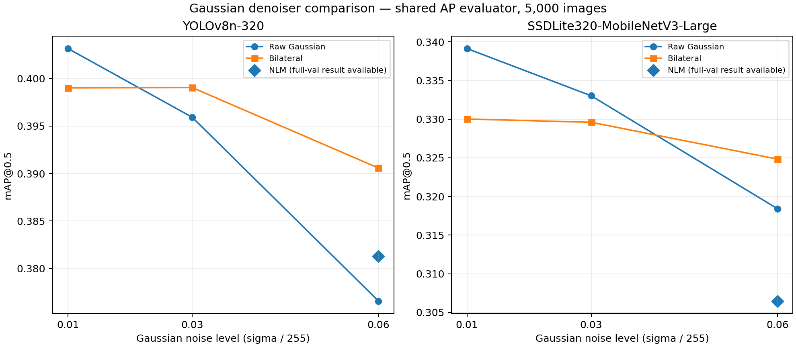

Bảng gồm FP/FN và mAP@0.5:0.95: `runs/normalized_detector_comparison_fullval/gaussian_denoiser_comparison.csv`. Tạo lại bằng `compare_gaussian_denoisers.py`. Các ảnh bilateral và confusion matrices: `runs/full_val2017_gaussian_bilateral_seed42/`; metrics chung của detector nằm trong hai file `runs/yolo_custom_fullval_seed42/metrics.csv` và `runs/ssdlite_fullval_seed42/metrics.csv`.

### Lặp full-val với ba seed noise

Để kiểm tra độ nhạy với mẫu Gaussian/Salt-and-Pepper, lặp ba điều kiện nặng trên cùng 5.000 ảnh bằng seed 42, 43 và 44; dùng cùng AP evaluator ở input 320. Bảng là mean ± độ lệch chuẩn mẫu của mAP@0.5 (n=3).

| Điều kiện | YOLOv8n-320 | SSDLite-320 |
|---|---:|---:|
| Gaussian 0.06 raw | 0.37694 ± 0.00052 | 0.31885 ± 0.00045 |
| Salt-and-Pepper 0.06 raw | 0.26222 ± 0.00175 | 0.22351 ± 0.00169 |
| Salt-and-Pepper 0.06 median | 0.39495 ± 0.00037 | 0.33012 ± 0.00067 |

Ba seed cho thấy kết quả Gaussian khá ổn định; S&P raw có biến thiên lớn hơn một chút, còn median vẫn phục hồi mạnh S&P 0.06 ở cả ba mẫu noise. SD chỉ phản ánh ba mẫu noise trên cùng một split COCO, không phải độ bất định theo ảnh hay nhiều benchmark độc lập; cần thêm seed/subset nếu cần suy luận thống kê mạnh.

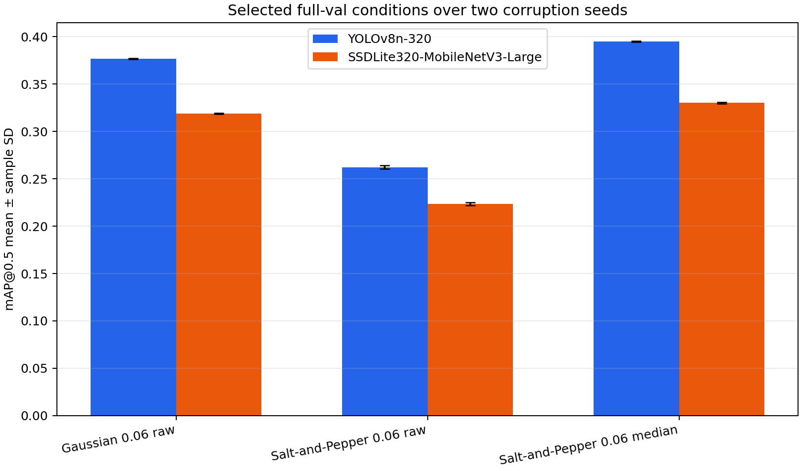

Bảng có mean/SD cho mAP@0.5, mAP@0.5:0.95, FP và FN: `runs/normalized_detector_comparison_fullval/seed_repeat_summary.csv`. Tái tạo bằng `aggregate_fullval_seeds.py`; dataset seed43/44 và validation logs nằm trong `runs/full_val2017_seed43_selected/`, `runs/full_val2017_seed44_selected/`.

### Kiểm tra định tính preprocessing trên cùng ảnh

Tạo panel trên một ảnh COCO val2017 có năm đối tượng gán nhãn. Hộp màu xanh là ground truth giống nhau ở cả ba cột. Quan sát minh họa cho thấy median loại phần lớn chấm Salt-and-Pepper; bilateral giảm nhiễu Gaussian nhưng làm mềm chi tiết; CLAHE tăng tương phản cục bộ trong ảnh fog. Ở ví dụ low-light này, CLAHE không khôi phục độ sáng tổng thể. Đây là một ảnh minh họa, không phải kết luận định lượng; số liệu mAP toàn tập là cơ sở so sánh.

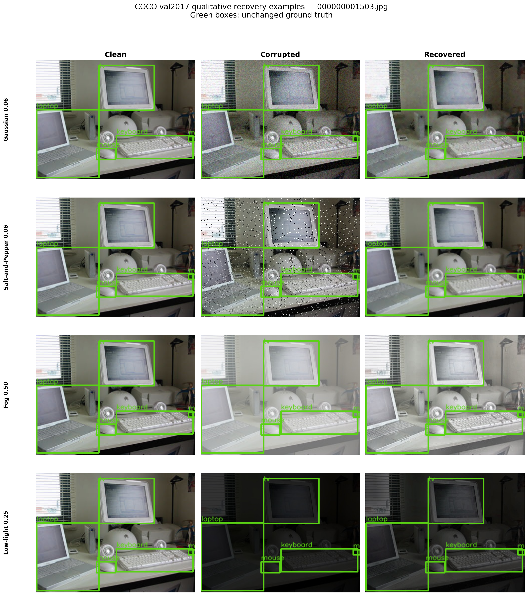

Tái tạo hình bằng `python create_qualitative_figure.py`; ảnh được chọn tự động theo số lượng bbox để giữ panel dễ đọc. Tên ảnh và điều kiện lưu trong `runs/qualitative_coco_examples/qualitative_recovery_examples.json`.

## Module denoising độc lập

Để dùng preprocessing ngoài benchmark, tách algorithms thành `preprocessing.py` và thêm CLI `denoise.py`. CLI nhận một ảnh hoặc thư mục ảnh, xuất kết quả và giữ cấu trúc thư mục con. `auto` ánh xạ Gaussian→NLM, Salt-and-Pepper→median, fog/low-light→CLAHE; có thể chọn thủ công `median`, `nlmeans`, `clahe` hoặc `bilateral`. Benchmark gọi lại cùng `recover_image`, tránh hai bản cài đặt khác nhau.

Ví dụ:

```powershell
python denoise.py --input D:/images/noisy --output D:/images/recovered --family salt_pepper
python denoise.py --input D:/images/noisy/photo.jpg --output D:/images/recovered/photo.jpg --family gaussian --method bilateral
```

CLI không ghi đè file sẵn có trừ khi thêm `--overwrite`. Đây là module xử lý ảnh độc lập; không cần tải model hoặc GPU.

Thêm chế độ `--level` để `auto` chọn preprocessing theo các mức đã đo trên COCO full-val cho cả YOLOv8n và SSDLite: Gaussian 0.01/0.03 và fog 0.15 dùng no-op; Gaussian 0.06 dùng bilateral; S&P dùng median ở cả ba mức; fog 0.30/0.50 và low-light 0.25/0.40 dùng CLAHE; low-light 0.60 dùng no-op. Tham số này chỉ nhận các level đã benchmark. Đây là policy được chọn dựa trên validation, chưa phải bộ phân loại nhiễu tự động và cần xác nhận trên dữ liệu độc lập.

## Kết luận nghiên cứu

Trên COCO val2017 đầy đủ với input 320 và evaluator chung, Salt-and-Pepper 0.06 gây suy giảm lớn nhất: mAP@0.5 giảm 35.3% ở YOLOv8n và 33.4% ở SSDLite. Median 3×3 khôi phục phần lớn hiệu năng, đưa mức giảm còn lần lượt 2.1% và 2.6% so baseline. Ở mức nặng, CLAHE cải thiện fog 0.50 và low-light 0.25 cho cả hai detector; ở mức nhẹ tác động nhỏ hoặc âm. Gaussian-NLM phụ thuộc kiến trúc và làm giảm mAP của SSDLite, trong khi bilateral giúp nhẹ ở Gaussian 0.06.

Kết quả trả lời câu hỏi nghiên cứu cho các biến dạng tổng hợp và hai checkpoint đã chọn; không đại diện cho fog/ban đêm ngoài thực tế. Ba seed full-val chỉ lặp mẫu nhiễu ở một số điều kiện nặng, còn các curve ba seed đầy đủ dùng cùng subset cố định 500 ảnh. Cần dữ liệu thực địa hoặc split độc lập để đánh giá khả năng khái quát và tránh chọn preprocessing trên chính tập báo cáo.

## Chọn checkpoint cho desktop MVP

Để xem liệu model nhỏ có phải nguyên nhân chính của mAP vừa phải hay không, chạy YOLOv8s pretrained trên đúng COCO val2017, 5.000 ảnh, imgsz 640, cùng pipeline Ultralytics như YOLOv8n. YOLOv8s nâng mAP@0.5 từ **0.5185 (51.85%) lên 0.6096 (60.96%)**, tăng **9.12 điểm phần trăm**; mAP@0.5:0.95 tăng từ **36.71% lên 44.23%** (+7.51 điểm). Ở confusion threshold 0.25, YOLOv8s có thêm 3.538 TP, giảm 3.538 FN và tăng 1.980 FP trên toàn val.

Đo single-image latency trên RTX 3060, imgsz 640, conf 0.25, IoU NMS 0.7, 200 ảnh qua hai lượt đảo thứ tự: YOLOv8n mean **9.76 ms**, YOLOv8s **10.33 ms**; median 8.36 / 8.76 ms, p95 12.73 / 15.26 ms. Peak CUDA allocation trong phép đo lần lượt **0.032 / 0.077 GB**. Đây là benchmark trên một GPU và một mẫu COCO, không đại diện mọi phần cứng hoặc domain.

Vì mAP tăng 9.12 pp với độ trễ trung bình tăng khoảng 0.57 ms/ảnh trên RTX 3060, desktop MVP mặc định chuyển sang YOLOv8s; checkpoint YOLOv8n vẫn giữ để so sánh tốc độ/độ chính xác. Kết quả chỉ xác nhận lựa chọn trên COCO. Quyết định fine-tune vẫn cần ảnh mục tiêu có nhãn.

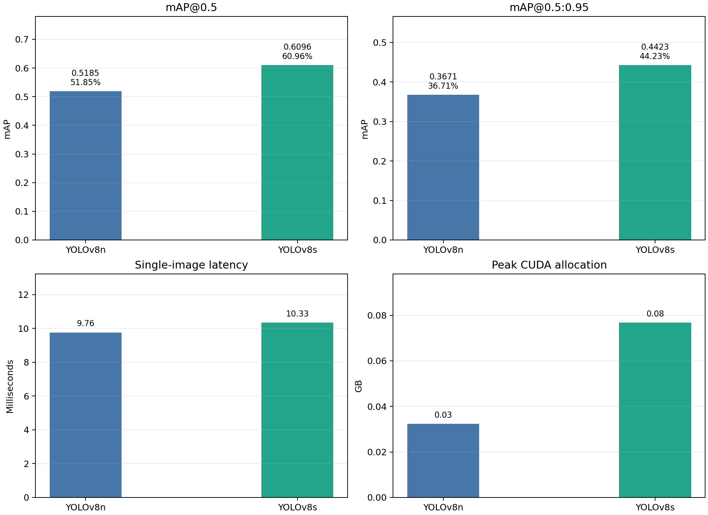

Metrics và latency CSV cùng script tái tạo nằm trong `runs/yolo_model_size_comparison/`; checkpoint `yolov8s.pt` SHA-256 `268E5BB54C640C96C3510224833BC2EEACAB4135C6DEB41502156E39986B562D`.

### Độ bền YOLOv8n và YOLOv8s dưới nhiễu — full val2017

Để kiểm tra xem lợi thế của YOLOv8s có còn giữ sau biến dạng hay không, chạy cả hai checkpoint trên cùng 5.000 ảnh COCO val2017, imgsz 640. So sánh dưới đây dùng đúng các ảnh raw/recovered đã benchmark; recovery là bilateral cho Gaussian, median cho Salt-and-Pepper, CLAHE cho fog và low-light.

| Điều kiện | YOLOv8n raw | YOLOv8s raw | YOLOv8n recovered | YOLOv8s recovered |
|---|---:|---:|---:|---:|
| Clean | 51.85% | 61.12% | — | — |
| Gaussian 0.06 | 43.87% | 53.90% | 48.17% | 57.24% |
| Salt-and-Pepper 0.06 | 24.59% | 28.40% | 49.36% | 58.03% |
| Fog 0.50 | 47.12% | 55.92% | 49.98% | 59.48% |
| Low-light 0.25 | 45.91% | 55.56% | 48.48% | 57.99% |

YOLOv8s có mAP tuyệt đối cao hơn YOLOv8n ở mọi điều kiện được so sánh, cả trước và sau recovery. Tuy nhiên, model lớn hơn không loại bỏ độ nhạy: raw Salt-and-Pepper vẫn giảm 32.72 điểm phần trăm so với clean YOLOv8s. Median recovery tăng 29.63 điểm, còn thiếu 3.10 điểm so với clean. Gaussian, fog và low-light cũng được cải thiện bởi recovery trong các mức nặng này. Các mức tăng là trên ảnh tổng hợp cùng COCO val; chưa xác nhận hiệu quả trên ảnh camera thực.

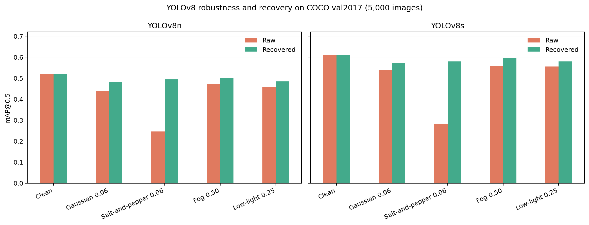

CSV chi tiết gồm mAP50, mAP50-95 và chênh lệch so với clean: `runs/yolov8_model_robustness_comparison/yolov8n_vs_yolov8s_robustness.csv`. Kết quả YOLOv8s đầy đủ 9 điều kiện: `runs/yolov8s_fullval_recovery_policy/metrics.csv`; tái tạo bảng/biểu đồ bằng `compare_yolov8_robustness.py`.

## Pilot external trên Open Images V7

Để kiểm tra tổng quát ngoài COCO, tạo một subset validation cố định gồm 100 ảnh và 193 box ở 8 lớp giao với nhãn dự án. So sánh YOLOv8n, YOLOv8s và SSDLite320-MobileNetV3-Large ở input size 320, cùng ảnh và cùng lớp. Evaluator dùng nhãn positive/negative của Open Images, bỏ qua dự đoán ở lớp chưa được gán trạng thái trên ảnh, và xử lý group-of boxes. Metric là mAP@0.5 trên 8 lớp; không báo mAP@0.5:0.95 vì giao thức Open Images dùng IoU 0.5. Phần triển khai là evaluator subset của dự án; không mở rộng class hierarchy.

| Model | mAP@0.5 | TP | FP | FN | Precision @ conf .25 | Recall @ conf .25 |
|---|---:|---:|---:|---:|---:|---:|
| YOLOv8n | **65.8%** | 114 | 50 | 79 | 69.5% | 59.1% |
| YOLOv8s | 65.4% | 119 | 69 | 74 | 63.3% | 61.7% |
| SSD-MobileNet | 61.9% | 105 | 62 | 88 | 62.9% | 54.4% |

YOLOv8n và YOLOv8s gần như ngang nhau về mAP (chênh 0.4 điểm phần trăm). Ở ngưỡng confidence 0.25, YOLOv8s tìm thêm 5 box đúng nhưng cũng có thêm 19 false positives so với YOLOv8n. Trong cả ba model, `couch` có AP thấp nhất (27.1–37.7%) trên subset này; lớp chỉ có 14 box nên cần thêm ví dụ trước khi kết luận. Đây là pilot 100 ảnh Open Images, không đại diện đầy đủ cho ảnh camera của sản phẩm và chưa đủ để quyết định fine-tune.

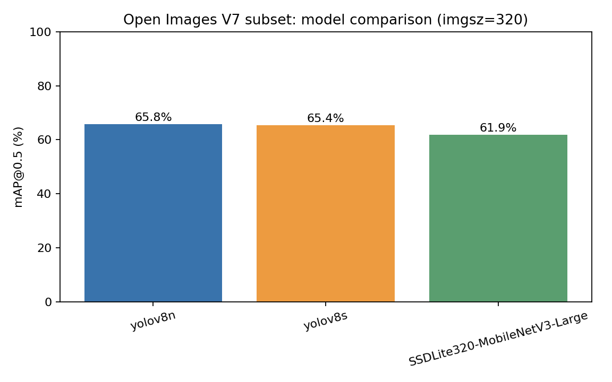

Biểu đồ per-class AP và confusion matrices nằm trong `runs/open_images_v7_eval/`; bảng số liệu là `summary.csv` và `per_class_ap50.csv`. Tái tạo bằng `python evaluate_open_images_subset.py --device 0 --imgsz 320 --batch 16`.

## Tài liệu tham khảo

1. Lin et al., [Microsoft COCO: Common Objects in Context](https://arxiv.org/abs/1405.0312), ECCV 2014.
2. [Ultralytics YOLOv8 documentation](https://docs.ultralytics.com/models/yolov8/) and [validation metrics guide](https://docs.ultralytics.com/modes/val/).
3. Torchvision, [SSDLite320 MobileNetV3 Large model and COCO_V1 weights](https://docs.pytorch.org/vision/main/models/generated/torchvision.models.detection.ssdlite320_mobilenet_v3_large.html).
4. OpenCV, [Image Denoising tutorial](https://docs.opencv.org/4.13.0/d5/d69/tutorial_py_non_local_means.html) and [photo denoising API](https://docs.opencv.org/4.11.0/d1/d79/group__photo__denoise.html).
5. COCO API, [COCOeval implementation](https://github.com/cocodataset/cocoapi/blob/master/PythonAPI/pycocotools/cocoeval.py), for the benchmark's IoU-threshold and interpolated AP conventions.
6. [Open Images evaluation protocol](https://storage.googleapis.com/openimages/web/evaluation.html), including handling of unannotated classes, image-level labels, and group-of boxes.

## COCO-80 fine-tuning pilot

Để giữ nguyên 80 lớp của baseline, tạo tập con 1.000 ảnh từ COCO Train2017 với đầy đủ annotation COCO-80 trên từng ảnh. So sánh các checkpoint fine-tune với baseline trên cùng COCO val2017 (5.000 ảnh); giữ checkpoint pretrained gốc riêng.

| Model | Input | Baseline mAP@0.5 | Sau fine-tune mAP@0.5 | Thay đổi |
|---|---:|---:|---:|---:|
| YOLOv8n | 640 | 51.92% | 33.65% | −18.27 điểm % |
| YOLOv8s | 640 | 60.96% | 26.76% | −34.20 điểm % |
| SSDLite320-MobileNetV3-Large | 320 | 33.86% | 31.13% | −2.73 điểm % |

Fine-tune 1.000 ảnh COCO không cải thiện model; hai YOLO giảm mạnh, còn SSD tăng false positives từ 6.933 lên 10.917. **Không dùng các checkpoint thử nghiệm này làm model sản phẩm.** Kết quả cho thấy tập con này không đủ để bảo toàn hiệu năng COCO-80 với cấu hình fine-tune hiện tại. Xem số liệu chi tiết tại `runs/finetune_coco80/comparison.csv`; checkpoint và log train nằm trong `runs/finetune_coco80/`.

Open Images V7 được **giữ lại** vì đã phục vụ external evaluation trên 100 ảnh/8 lớp giao với COCO và được ghi trong phần pilot external ở trên. Nó không phải dữ liệu train COCO-80. HomeObjects-3K đã bị xóa theo yêu cầu vì chỉ có 12 lớp.

## Tiled inference pilot trên COCO val2017

So sánh YOLOv8s full-frame với inference theo tile 640px, overlap 25%, gộp box theo lớp bằng NMS IoU 0.55 trên cùng 5.000 ảnh COCO val2017 ở imgsz 640. AP dùng conf 0.001; TP/FP/FN và recall theo kích thước dùng conf 0.25, IoU 0.5.

| Chế độ | mAP@0.5 | mAP@0.5:0.95 | TP / FP / FN | Recall small | Recall medium | Recall large |
|---|---:|---:|---:|---:|---:|---:|
| Full-frame | 59.79% | 43.75% | 21,317 / 10,576 / 15,018 | 31.69% | 63.46% | 81.14% |
| Tiled 640px | 60.26% | 43.23% | 21,188 / 9,350 / 15,147 | 31.40% | 63.14% | 80.74% |

Tiling giảm 1.226 false positives nhưng recall small giảm 0.30 điểm phần trăm và false negatives tăng 129; mAP@0.5 tăng 0.47 điểm nhưng mAP@0.5:0.95 giảm 0.53 điểm. Vì vậy pilot này **không chứng minh tiling giúp phát hiện vật thể nhỏ tốt hơn**. Giữ tùy chọn trong app ở trạng thái tắt mặc định; cần ảnh mục tiêu có nhãn độc lập trước khi chọn chế độ cho sản phẩm. CSV: `runs/tiled_inference_eval/summary.csv`.


## COCO-80 fine-tuning follow-up (5K images, YOLOv8n)

Using 5,000 COCO Train2017 images with full 80-class annotations, the 5-epoch pilot reached 47.87% best mAP@0.5 / 33.12% mAP@0.5:0.95. A run capped at 50 epochs with early stopping (patience 8) stopped after epoch 11; best was epoch 3 at 43.30% / 29.09%. This remains below the 51.92% baseline mAP@0.5, so do not deploy the fine-tuned checkpoint. A longer epoch cap did not guarantee improvement. The 5-epoch and 50-epoch runs use different LR schedules because the schedule depends on total epochs, so this is not a controlled ablation of epoch count alone. Full logs are in `runs/finetune_coco80/yolov8n_coco80_5k_lr0002/` and `runs/finetune_coco80/yolov8n_coco80_5k_lr0002_50ep/`.

## Noise-aware fine-tuning pilot — YOLOv8n

A paired 10K-image training split was made from the existing COCO Train2017 5K subset: each source has one clean and one synthetic counterpart. Noise family/severity and label mapping follow the robustness pipeline; validation remains the untouched 5K COCO val2017 corruption sweep (seed42). The checkpoint was fine-tuned from original `yolov8n.pt` for up to 10 epochs (best clean-validation epoch 7). It is evaluated against the original checkpoint using the same pre-generated val images and Ultralytics mAP protocol.

| Validation condition | Baseline mAP50 | Noise-aware mAP50 | Change |
|---|---:|---:|---:|
| Clean | 51.85% | 47.30% | −4.55 pp |
| Gaussian 0.01 / 0.03 / 0.06 | 51.61 / 49.27 / 43.87% | 47.19 / 45.55 / 42.12% | −4.42 / −3.72 / −1.75 pp |
| Salt-and-Pepper 0.01 / 0.03 / 0.06 | 43.37 / 34.64 / 24.59% | 44.80 / 41.33 / 36.78% | +1.42 / +6.69 / +12.20 pp |
| Fog 0.15 / 0.30 / 0.50 | 51.08 / 49.85 / 47.12% | 47.02 / 46.52 / 45.46% | −4.06 / −3.33 / −1.66 pp |
| Low-light factor 0.60 / 0.40 / 0.25 | 51.20 / 49.65 / 45.91% | 47.10 / 46.40 / 44.47% | −4.10 / −3.24 / −1.44 pp |

Mean absolute mAP50 across the 12 noisy conditions changes from 45.18% to 44.56% (−0.62 pp). Mean degradation from each model's own clean score improves from 6.66 pp to 2.74 pp (+3.93 pp in relative robustness), partly because clean mAP itself falls by 4.55 pp. The substantial absolute gain is specific to Salt-and-Pepper. At its severe level, TP/FP/FN at conf0.25 and IoU0.5 are baseline 9,233/5,212/27,102 versus noise-aware 13,778/9,401/22,557. Baseline plus median recovery on the same condition reaches 49.36% mAP50 and TP/FP/FN=16,897/8,168/19,438, better than the noise-aware checkpoint on both AP and confusion counts. The mAP/recall gain from fine-tuning comes with a large false-positive increase. **Keep the original pretrained checkpoint with the tested preprocessing policy as the product path. Do not deploy the noise-aware checkpoint globally.**

Confidence threshold sweep (0.05/0.25/0.50) confirms that raising the threshold reduces false positives but also lowers recall. At conf0.50, TP/FP/FN are 6,254/1,264/30,081 for baseline raw, 9,609/2,223/26,726 for noise-aware raw, and 12,438/1,890/23,897 for baseline+median. The recovered baseline still gives more true positives with fewer false positives than the noise-aware model. Full counts: `runs/noiseaware_yolov8n_eval_seed42/salt_pepper_confidence_thresholds.csv`.

Reproduction scripts: `prepare_noise_aware_train.py`, `finetune_yolo.py`, `evaluate_checkpoint_corruption_sweep.py`, and `compare_noiseaware_sweep.py`. Results and curve: `runs/noiseaware_yolov8n_fullval_sweep_seed42/`.

## Three-detector comparison at 320 px and YOLO comparison at 640 px

Added a full 5,000-image YOLOv8s evaluation at 320 px using the same 101-point AP evaluator, input size, image IDs, and confusion-count thresholds as the existing YOLOv8n/SSDLite comparison. The 640 px table pairs existing full-validation YOLOv8n and YOLOv8s measurements under the same Ultralytics validation protocol; it does not rerun those measurements. SSDLite is listed only at its native 320 px input.

| Condition | YOLOv8n 320 | YOLOv8s 320 | SSDLite 320 | YOLOv8n 640 | YOLOv8s 640 |
|---|---:|---:|---:|---:|---:|
| Clean | 40.37% | 49.12% | 33.86% | 51.85% | 61.12% |
| Gaussian 0.06 raw | 37.66% | 46.40% | 31.84% | 43.87% | 53.90% |
| Gaussian recovered | 38.13% | 46.57% | 30.65% | 48.17% | 57.24% |
| Salt-and-Pepper 0.06 raw | 26.12% | 32.17% | 22.54% | 24.59% | 28.40% |
| Salt-and-Pepper recovered | 39.51% | 48.12% | 32.98% | 49.36% | 58.03% |
| Fog 0.50 raw | 35.76% | 44.23% | 30.05% | 47.12% | 55.92% |
| Fog recovered | 38.59% | 47.81% | 32.23% | 49.98% | 59.48% |
| Low-light 0.25 raw | 34.82% | 43.80% | 28.72% | 45.91% | 55.56% |
| Low-light recovered | 37.28% | 46.25% | 30.50% | 48.48% | 57.99% |

The 320 px Gaussian recovery uses NLM; the 640 px comparison uses bilateral for Gaussian. Both sizes use median for Salt-and-Pepper and CLAHE for fog/low-light. Compare models only within the same input-size protocol. The 320 px CSV and charts are in `runs/normalized_detector_comparison_fullval/`; YOLO-only 640 px records are in `runs/yolo_family_comparison_640_fullval/`. Recreate the 320 px YOLOv8s inference with `yolo_custom_eval.py`, then run `compare_detectors_normalized.py` to rebuild both web sources.
